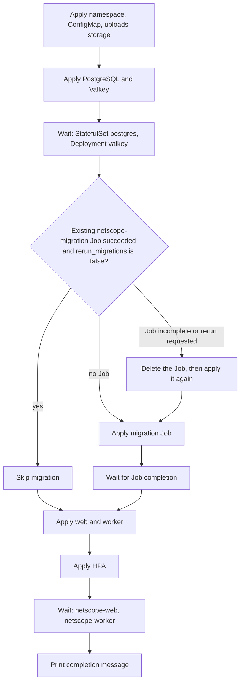

# NetScope Ansible Automation

This directory automates the deployment of NetScope to a local Minikube cluster. Instead of running a long sequence of `kubectl` commands by hand (see [`../k8s/README.md`](../k8s/README.md)), three playbooks check the environment, apply the existing Kubernetes manifests in the correct order, and verify the result.

Ansible runs **locally** against `localhost` (`ansible_connection=local`). Remote or SSH-based deployment is not implemented.

The playbooks reuse the manifests in [`../k8s/`](../k8s/); they do not duplicate any Kubernetes configuration.

## Table of Contents

- [What is automated](#what-is-automated)
- [Directory structure](#directory-structure)
- [Configuration files](#configuration-files)
- [Prerequisites](#prerequisites)
- [Playbooks](#playbooks)
  - [prerequisites.yml](#prerequisitesyml)
  - [deploy.yml](#deployyml)
  - [verify.yml](#verifyyml)
- [Running the playbooks](#running-the-playbooks)
- [Test results](#test-results)
- [Behaviour notes](#behaviour-notes)
- [Troubleshooting](#troubleshooting)
- [Limitations and possible improvements](#limitations-and-possible-improvements)

## What is automated

| Automated by Ansible | Not automated (do it beforehand) |
|---|---|
| Checking Minikube, `kubectl`, the Kubernetes context, the namespace, the Secret and the persistent claims | Starting Minikube |
| Applying the namespace, ConfigMap, storage, PostgreSQL, Valkey, web, worker and HPA manifests | Building the `netscope:local` image and loading it into Minikube (`minikube image load netscope:local`) |
| Waiting for PostgreSQL, Valkey, the migration Job, the web Deployment and the worker Deployment | Creating the `netscope-secrets` Secret (the playbooks only check that it exists; they never read or print its values) |
| Running the database migration Job once, and re-running it on request | Installing Metrics Server (needed by the HPA and by `verify.yml`) |
| Reporting workloads, storage, migration, HPA and resource metrics | Running load tests (see the Locust section of the Kubernetes README) |

## Directory structure

```text
ansible/
├── ansible.cfg
├── inventory.ini
├── README.md
└── playbooks/
    ├── prerequisites.yml
    ├── deploy.yml
    └── verify.yml
```

## Configuration files

**`ansible.cfg`**

```ini
[defaults]
inventory = ./inventory.ini
interpreter_python = auto_silent
retry_files_enabled = False
host_key_checking = False

[privilege_escalation]
become = False
```

| Setting | Effect |
|---|---|
| `inventory = ./inventory.ini` | Uses the local inventory. The path is relative, so run `ansible-playbook` from this `ansible/` directory. |
| `interpreter_python = auto_silent` | Lets Ansible discover a Python interpreter without warnings (the inventory also pins one, below). |
| `retry_files_enabled = False` | No `.retry` files are written. |
| `host_key_checking = False` | Not relevant for a local connection. |
| `become = False` | No privilege escalation: the playbooks run as your user and need no `sudo`. |

**`inventory.ini`**

```ini
[local]
localhost ansible_connection=local ansible_python_interpreter=/usr/bin/python3
```

One host, `localhost`, using the local connection and `/usr/bin/python3`. If your Python is installed elsewhere, change the interpreter path.

## Prerequisites

Install and have ready on the machine that runs the playbooks:

| Requirement | Notes |
|---|---|
| Ansible Core | Developed and tested with Ansible Core 2.22.0. |
| `kubectl` | On `PATH`, with a context pointing at Minikube. Tested with kubectl 1.37.2. |
| Minikube | Running, on `PATH`. Tested with Minikube 1.38.1 (Docker driver). |
| Image in the cluster | `netscope:local` loaded with `minikube image load netscope:local`. The manifests use `imagePullPolicy: IfNotPresent` and do not pull from a registry. |
| Secret | `netscope-secrets` in the `netscope` namespace, with the keys `POSTGRES_PASSWORD` and `NETSCOPE_SECRET_KEY` (see step 2 of [`../k8s/README.md`](../k8s/README.md)). |
| Metrics Server | Needed for the HPA and for the resource-metrics step of `verify.yml`. |

The development environment was Fedora Linux with Docker. All playbooks use `ansible.builtin.command` to call `kubectl` and `minikube`, so both must be on `PATH` when you run them.

## Playbooks

### prerequisites.yml

A read-only check. It changes nothing in the cluster. It runs ten tasks:

| Check | Command |
|---|---|
| Minikube status | `minikube status` |
| Current Kubernetes context | `kubectl config current-context` |
| Node availability | `kubectl get nodes` |
| Ansible installed | `ansible --version` |
| `kubectl` client available | `kubectl version --client` |
| Namespace exists | `kubectl get namespace netscope` |
| Secret exists | `kubectl get secret netscope-secrets -n netscope -o name` (prints only the resource name, never values) |
| Persistent claims exist | `kubectl get pvc postgres-data-postgres-0 uploads-pvc -n netscope` |
| **Context is `minikube`** | `assert` that the current context equals `minikube`; stops with "Expected Minikube context. Stopping deployment." otherwise |
| Summary | Prints a short confirmation message |

Because it checks for an **existing** namespace, Secret and claims, it is meant for an environment that has already been set up. On a brand-new cluster it fails at the namespace check; see [first-time deployment](#first-time-deployment).

### deploy.yml

Applies the manifests from `../k8s/` in dependency order and waits for each stage. The repository root is derived from the playbook location (`playbook_dir`), so the playbook finds the manifests regardless of the directory it is started from.



| Stage | Tasks |
|---|---|
| Foundation | Apply `namespace.yaml`, `configmap.yaml`, `storage.yaml`. |
| Data services | Apply `postgres.yaml` and `valkey.yaml`; wait for `statefulset/postgres` (180 s) and `deployment/valkey` (120 s). |
| Migration | Read `.status.succeeded` of Job `netscope-migration`. If the Job is missing, apply it. If it exists but has not succeeded, or `rerun_migrations` is true, delete it and apply it again. If it already succeeded, skip. When the Job was applied, wait up to 180 s for it to complete. |
| Application | Apply `web.yaml` and `worker.yaml`. |
| Autoscaling | Apply `hpa.yaml`. |
| Readiness | Wait for `deployment/netscope-web` and `deployment/netscope-worker` (180 s each), then print "NetScope deployment completed successfully." |

The only variable is:

```yaml
rerun_migrations: false
```

Override it on the command line to force a migration re-run (see below). Deleting the migration Job removes only the Job; it does not touch the PostgreSQL StatefulSet or any persistent volume claim.

### verify.yml

A read-only report. It runs five `kubectl` queries and prints the output together:

| Query | Shows |
|---|---|
| `kubectl get deployments,statefulsets,pods,services -n netscope` | Workload readiness and Services |
| `kubectl get pvc -n netscope` | Persistent claims and their status |
| `kubectl get jobs -n netscope` | Migration Job completion |
| `kubectl get hpa -n netscope` | Autoscaler targets and replica counts |
| `kubectl top pods -n netscope` | Pod CPU and memory (requires Metrics Server) |

`verify.yml` displays the state; it does not assert that everything is ready. Read the output (or watch for a failing `kubectl` command) to judge health.

## Running the playbooks

Run every command from the `ansible/` directory so that `ansible.cfg` and `inventory.ini` are found.

```bash
cd ansible
```

### First-time deployment

On a cluster where NetScope has never been deployed, create the namespace and the Secret first. The playbooks do not create the Secret, and PostgreSQL and the application pods cannot start without it:

```bash
kubectl apply -f ../k8s/namespace.yaml
kubectl create secret generic netscope-secrets \
  --namespace netscope \
  --from-literal=POSTGRES_PASSWORD="$(openssl rand -hex 24)" \
  --from-literal=NETSCOPE_SECRET_KEY="$(openssl rand -base64 48)"
minikube image load netscope:local
ansible-playbook playbooks/deploy.yml
ansible-playbook playbooks/verify.yml
```

Use a hex password: it is placed inside a database URL by the manifests. Never commit secret values.

### Regular deployment

```bash
ansible-playbook playbooks/prerequisites.yml   # check the environment and context
ansible-playbook playbooks/deploy.yml          # apply the manifests
ansible-playbook playbooks/verify.yml          # report the result
```

Run `prerequisites.yml` first: it is the only playbook that checks the Kubernetes context. `deploy.yml` applies to whichever context is current.

### Re-running migrations

A completed migration Job is skipped on normal deployments. To delete and recreate it deliberately (for example after loading an image that contains new migrations):

```bash
ansible-playbook playbooks/deploy.yml -e rerun_migrations=true
```

### Optional syntax check

```bash
ansible-playbook playbooks/deploy.yml --syntax-check
```

## Test results

The playbooks were executed against the Minikube deployment with these recorded results:

| Command | Result | Notes |
|---|---|---|
| `ansible-playbook playbooks/prerequisites.yml` | `ok=10 changed=0 unreachable=0 failed=0` | All checks passed; no Secret values printed. |
| `ansible-playbook playbooks/deploy.yml` | `ok=14 changed=1 failed=0 skipped=3` | The completed migration Job was skipped. |
| `ansible-playbook playbooks/deploy.yml -e rerun_migrations=true` | `ok=17 changed=3 failed=0 skipped=0` | The Job was deleted, recreated and completed. |
| `ansible-playbook playbooks/verify.yml` | `ok=6 changed=0 failed=0` | See below. |

`verify.yml` confirmed:

| Component | State |
|---|---|
| Web Deployment | 1/1 ready |
| Worker Deployment | 1/1 ready |
| Valkey Deployment | 1/1 ready |
| PostgreSQL StatefulSet | 1/1 ready |
| PostgreSQL PVC | `Bound`, 2Gi |
| Uploads PVC | `Bound`, 2Gi |
| Migration Job | Complete, 1/1 |
| HPA | Active, CPU 1%/50%, minimum 1, maximum 5, 1 replica |
| Pod resource metrics | Available |

After the deployment, the application was exposed with `kubectl port-forward -n netscope service/netscope-web 8000:8000` and `GET /api/v1/health` returned the healthy response:

```bash
curl -i http://localhost:8000/api/v1/health
```

## Behaviour notes

- **Context safety.** Only `prerequisites.yml` checks that the context is `minikube`. `deploy.yml` does not, so check before deploying if you use several clusters.
- **`changed` reporting.** Each apply task reports `changed` when `kubectl apply` prints `created` or `configured`. The PostgreSQL apply task was reported as `changed` even though `kubectl diff -f ../k8s/postgres.yaml` produced no output. This is a reporting quirk that has not been fixed; the deployment itself was not affected.
- **Replica count.** `web.yaml` declares `replicas: 1`, so running `deploy.yml` while the HPA has scaled the web Deployment resets it to one replica; the HPA then scales it up again if load persists.
- **Persistent data.** No playbook deletes a PersistentVolumeClaim, a PersistentVolume or any database storage, and none should be added to routine deployment or cleanup. The only deletion performed is the migration Job.
- **Secrets.** The Secret is created outside Ansible and is never read or printed by the playbooks.

## Troubleshooting

| Symptom | What to check |
|---|---|
| `Expected Minikube context. Stopping deployment.` | The current context is not `minikube`. Run `kubectl config current-context` and `kubectl config use-context minikube`. |
| `prerequisites.yml` fails on the namespace, Secret or PVC check | The environment has not been set up yet. Follow [first-time deployment](#first-time-deployment); the PVC check passes only after PostgreSQL and the uploads claim have been created. |
| `minikube` or `kubectl: command not found` | Install the tool or fix `PATH`; the playbooks call both directly. |
| No inventory or `localhost` warnings | Run from the `ansible/` directory so `ansible.cfg` is picked up. |
| Wait for PostgreSQL or Valkey times out | `kubectl get pods -n netscope` and `kubectl describe pod <pod> -n netscope`. A missing `netscope-secrets` Secret or a missing image are common causes. |
| Image errors (`ErrImageNeverPull`, `ImagePullBackOff`) | Run `minikube image load netscope:local`. |
| Wait for migration times out or the Job fails | `kubectl logs job/netscope-migration -n netscope`. Check PostgreSQL readiness and that the Secret password matches the database. |
| `verify.yml` fails on `kubectl top` | Metrics Server is not running or not ready yet; check `kubectl top nodes`. |

## Limitations and possible improvements

Implemented behaviour is described above. The following are **not** implemented:

- Starting Minikube, building or loading the image, and creating the Secret are manual steps.
- Remote or SSH-based deployment: the inventory contains only `localhost`.
- `deploy.yml` does not check the Kubernetes context; `verify.yml` reports state without asserting readiness.
- The PostgreSQL `changed` reporting quirk described above.

Possible future improvements: run the context check inside `deploy.yml`, add readiness assertions to `verify.yml`, manage the Secret with Ansible Vault, and organise the tasks into roles.