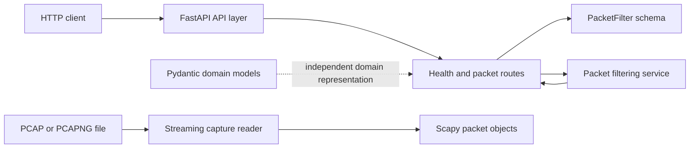

# NetScope

NetScope is a multi-user network traffic analysis and intelligence platform.
Its intended purpose is to let users upload network captures, inspect packets
and flows, understand protocol behavior, and use traffic statistics and reports
to investigate network activity.

The project is being developed incrementally. The current repository contains
the initial FastAPI backend, domain models, a packet-filtering prototype, and a
validated streaming reader for PCAP and PCAPNG files. It is not yet a
production-ready platform.

## Current Development Status

### Implemented

- A Python package containing a FastAPI application.
- `GET /` and `GET /health` endpoints.
- `POST /packets/filter`, backed by an in-memory packet-filtering service.
- Pydantic models for captures, packets, and transport protocols.
- Scapy-based streaming iteration over PCAP and PCAPNG files.
- Signature-based capture format detection and structural validation.
- Unit and API tests covering the current implementation.

### Work currently in progress

The repository is at the foundation stage of the analysis engine. The capture
reader is available, but the next analysis-engine step is to convert the
Scapy packets it yields into the NetScope `Packet` domain model and then add
protocol extraction and analytics.

### Planned

The broader platform still needs persistence, authentication, upload and job
management, packet analysis, flow reconstruction, reporting, a frontend, and
deployment infrastructure. Those areas are not implemented in this repository
state.

## Current Implementation

### Backend

- **Python:** `>=3.12.16`
- **Web framework:** FastAPI
- **Application server:** Uvicorn
- **Project and dependency management:** uv
- **Health endpoint:** `GET /health`
- **Packet filtering:** `POST /packets/filter`, using
  [`app/services/packet_service.py`](app/services/packet_service.py) and a
  small in-memory sample packet list defined by the route

The packet-filtering prototype currently supports filtering by `protocol` and
`source_ip`. It is not connected to capture files or persistent storage.

### Domain Models

The domain models are Pydantic 2 models independent of FastAPI route handlers:

- `Capture`
- `CaptureFormat`
- `CaptureStatus`
- `Packet`
- `TransportProtocol`

They provide structured validation and Pydantic serialization for capture and
packet data. Protocol-layer fields on `Packet` are nullable so unavailable
information can remain unavailable rather than being represented by fabricated
zero values.

### Capture Ingestion

[`app/services/capture_reader.py`](app/services/capture_reader.py) provides
`iter_capture_packets(path)`, which:

- Reads PCAP and PCAPNG files through Scapy.
- Yields packets one at a time instead of loading the complete capture into
  memory.
- Detects the format from file signatures rather than filename extensions.
- Supports PCAP byte-order and microsecond/nanosecond timestamp variants.
- Handles PCAPNG files containing multiple sections with different byte orders.
- Performs a structural validation pass before Scapy iteration.
- Detects empty, truncated, corrupt, unsupported, and malformed captures.
- Closes the Scapy reader when iteration completes or fails.
- Raises `CaptureReadError` for capture-specific read failures.

The capture reader is not a packet extraction pipeline. It currently yields
Scapy packet objects; it does not populate the NetScope `Packet` Pydantic model,
extract Ethernet/IP/TCP/UDP fields, decode application protocols, or calculate
capture-level statistics.

## Architecture

The current architecture is intentionally small:

- **API layer:** `app/main.py` creates the FastAPI application and includes the
  health and packet routes. Route handlers receive HTTP requests and return
  responses.
- **Schema layer:** `app/schemas/packet.py` defines `PacketFilter`, the request
  model for packet filtering.
- **Service layer:** `app/services/packet_service.py` applies the current
  in-memory packet filters. `app/services/capture_reader.py` handles validated,
  streaming capture iteration.
- **Domain models:** `app/models/` contains Pydantic representations of
  captures and extracted packet data. These models are not database models.
- **Capture reader:** the reader is independent of FastAPI and is not wired to
  an upload route or the packet-filtering service.



There is currently no persistence layer, authentication layer, background
worker, upload endpoint, analysis pipeline, or frontend in the repository.

## Project Structure

The relevant implemented structure is:

```text
netscope/
├── app/
│   ├── main.py
│   ├── api/
│   │   └── routes/
│   │       ├── health.py
│   │       └── packets.py
│   ├── core/
│   │   └── __init__.py
│   ├── models/
│   │   ├── __init__.py
│   │   ├── capture.py
│   │   └── packet.py
│   ├── schemas/
│   │   ├── __init__.py
│   │   └── packet.py
│   ├── services/
│   │   ├── __init__.py
│   │   ├── capture_reader.py
│   │   └── packet_service.py
│   └── workers/
│       └── __init__.py
├── tests/
│   ├── test_api.py
│   ├── test_capture_reader.py
│   ├── test_models.py
│   └── test_packet_service.py
├── pyproject.toml
├── uv.lock
├── LICENSE
└── README.md
```

The `core` and `workers` packages currently contain only package
initialization files; they do not provide database or background-processing
functionality yet.

## Technology Stack

### Currently implemented

| Area | Technology |
| --- | --- |
| Language | Python `>=3.12.16` |
| API | FastAPI |
| ASGI server | Uvicorn |
| Validation and domain representation | Pydantic 2 |
| Capture reading | Scapy |
| Project and dependency management | uv |
| Testing | Pytest |
| API test client support | `httpx2` for the installed Starlette version |

### Planned or assigned to future components

The following technologies are not currently used by the implemented backend:

- PostgreSQL and SQLAlchemy for persistence.
- Celery and Redis for background processing.
- Docker, Kubernetes, Kubernetes autoscaling, Locust, and Ansible for
  deployment, scaling, testing, and automation.
- HTML, CSS, JavaScript, Tailwind CSS, Chart.js, or another frontend stack for
  the user interface.

Database integration, authentication, frontend work, reports, and deployment
are separate project components being handled by other team members.

## Setup and Installation

### Prerequisites

- Python 3.12.16 or newer.
- [uv](https://docs.astral.sh/uv/) installed and available on `PATH`.

### Clone the repository

```bash
git clone https://github.com/Rajlohith/devops-pbl.git
cd devops-pbl/netscope
```

### Install dependencies

From the `netscope` project directory:

```bash
uv sync
```

The project is configured as a uv-managed package. The default development
dependency group installs the test dependencies as well as the runtime
dependencies.

### Run the development server

```bash
uv run uvicorn app.main:app --reload
```

The API is then available at `http://127.0.0.1:8000`. FastAPI's generated
OpenAPI documentation is available at `/docs`, although the implemented API
surface is limited to the endpoints described below.

### Run the tests

```bash
uv run pytest
```

## API Documentation

The current API has three endpoints.

| Method | Path | Purpose |
| --- | --- | --- |
| `GET` | `/` | Returns the NetScope welcome message. |
| `GET` | `/health` | Returns the application health status. |
| `POST` | `/packets/filter` | Filters the route's in-memory sample packets. |

### `GET /`

Response status: `200 OK`

```json
{
  "message": "Welcome to NetScope"
}
```

### `GET /health`

Response status: `200 OK`

```json
{
  "status": "healthy"
}
```

### `POST /packets/filter`

The request body is a `PacketFilter` object. Both fields are optional strings:

```json
{
  "protocol": "TCP",
  "source_ip": "192.168.1.10"
}
```

The response contains the normalized filter values and the matching entries
from the route's in-memory sample list:

```json
{
  "message": "Filter applied successfully",
  "filters": {
    "protocol": "TCP",
    "source_ip": "192.168.1.10"
  },
  "packets": [
    {
      "protocol": "TCP",
      "source_ip": "192.168.1.10",
      "destination_ip": "192.168.1.20"
    },
    {
      "protocol": "TCP",
      "source_ip": "192.168.1.10",
      "destination_ip": "192.168.1.30"
    }
  ]
}
```

An empty JSON object is valid and returns all four sample packets. Payloads
with values of the wrong type are rejected by FastAPI/Pydantic with
`422 Unprocessable Entity`.

## Data Models

### Capture

`Capture` represents metadata for an uploaded capture file. Its fields include:

- `id`: generated UUID.
- `owner_user_id`: optional UUID reference reserved for future ownership
  integration.
- `original_filename`: required, trimmed, non-empty string.
- `file_format`: `pcap` or `pcapng`.
- `file_size_bytes`: positive integer.
- `status`: one of `uploaded`, `pending`, `processing`, `completed`, or
  `failed`.
- `uploaded_at`: generated timezone-aware timestamp.
- `processing_started_at` and `processing_completed_at`: optional timestamps.
- `error_message`: optional failure information.

The model does not persist files, enforce status transitions, or connect to a
user model.

### Packet

`Packet` represents an extracted packet record and requires:

- `capture_id`, `packet_number`, `timestamp`, `captured_length`, and
  `original_length`.
- Optional Ethernet fields: `source_mac`, `destination_mac`, `ether_type`, and
  `vlan_id`.
- Optional network fields: source/destination IP addresses, IP version,
  TTL/hop limit, and transport protocol.
- Optional transport fields: ports, TCP flags and sequence/acknowledgement
  numbers, and UDP length.
- Optional application protocol and flexible `application_metadata`.

Important validation rules include positive packet numbers, non-negative
lengths, `captured_length <= original_length`, valid IPv4/IPv6 values,
matching supplied IP versions, timezone-aware timestamps, six-octet MAC
addresses, valid port and field ranges, and VLAN IDs from `0` through `4094`.
Unavailable protocol-layer data remains `null`.

`application_metadata` is intended for decoded protocol metadata, such as DNS
or HTTP information. It is not an unrestricted raw-payload store.

### TransportProtocol

`TransportProtocol` can represent a protocol by its IP protocol `number`, a
readable `name`, or both. At least one must be provided. Known number/name
pairs must agree, while unknown numbers and names remain supported for future
protocols.

Representative serialized packet data:

```json
{
  "capture_id": "4f0e2e8d-4c8f-4de5-8e1d-8f4e3b2bb5f7",
  "packet_number": 1,
  "timestamp": "2026-01-01T12:00:00Z",
  "captured_length": 100,
  "original_length": 100,
  "source_mac": "00:11:22:33:44:55",
  "destination_mac": "66:77:88:99:aa:bb",
  "ether_type": 2048,
  "vlan_id": null,
  "source_ip": "192.168.1.10",
  "destination_ip": "192.168.1.20",
  "ip_version": 4,
  "ttl_or_hop_limit": 64,
  "transport_protocol": {
    "number": 6,
    "name": "TCP"
  },
  "source_port": 1234,
  "destination_port": 443,
  "tcp_flags": "SYN",
  "tcp_sequence_number": 10,
  "tcp_acknowledgement_number": 0,
  "udp_length": null,
  "application_protocol": "HTTP",
  "application_metadata": {
    "method": "GET"
  }
}
```

## Testing

The test suite is run with Pytest and currently covers:

- Root, health, packet-filtering, valid-request, and invalid-payload API
  behavior.
- Packet filtering by protocol, source IP, both fields, empty filters, and
  non-matching filters.
- Capture and packet construction, enum validation, field validation,
  optional protocol layers, serialization, timestamp and IP-version rules,
  MAC addresses, and packet-length constraints.
- PCAP and PCAPNG reading, empty captures, multiple packets, byte-order and
  timestamp-precision variants, mixed-endian PCAPNG sections, malformed
  structures, truncation, unsupported files, and resource-safe reading.

Run the complete suite with:

```bash
uv run pytest
```

## Current Limitations and Next Steps

The analysis-engine scope does not yet include:

- Ethernet and IP field extraction into NetScope `Packet` models.
- TCP and UDP field extraction.
- Application protocol metadata extraction.
- A capture-to-model conversion pipeline.
- Flow reconstruction.
- Protocol analytics.
- Traffic performance analytics.

The following broader platform components are also outside the current
implementation and are being handled separately by other team members:

- Database integration and persistent capture ownership.
- Authentication and authorization.
- Frontend functionality.
- Reports.
- Deployment and infrastructure automation.

The next analysis-engine milestone should build on the streaming capture reader
by extracting available protocol fields into the existing domain models while
preserving nullability for layers that are not present.